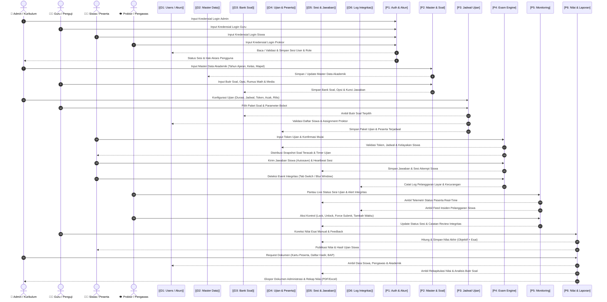

# Data Flow Diagram (DFD) Level 1 — Sistem SAPTA CBT
*(Format Aliran Data Vertikal / Lifeline Sequence Matrix — Sesuai Referensi)*

Dokumen ini memodelkan aliran data fungsional dari Sistem Computer Based Test (**SAPTA CBT**) menggunakan format **Lifeline Matrix / Vertical Sequence Data Flow Diagram** sebagaimana standar teknis akademik yang menyandingkan:
1. **Entitas Eksternal (Aktor)** di kolom kiri (dengan ikon figur orang)
2. **Data Stores (Basis Data)** di kolom tengah (dengan ikon silinder basis data `D1` – `D6`)
3. **Proses Sistem (Sub-Proses)** di kolom kanan (dengan ikon tombol proses `P1` – `P6`)
4. **Garis Pandu Vertikal (Lifeline)** yang menghubungkan aksi dari atas ke bawah secara kronologis

---

## 1. Gambar Diagram DFD Level 1

Diagram telah di-render dalam resolusi tinggi (High Definition) dan dapat dilihat langsung atau diunduh:

> 💡 **File Tersedia:**
> - Versi Gambar HD (PNG 2200x1816 px): [public/docs/dfd_level_1_reference.png](file:///c:/laragon/www/cbt-sapmar/public/docs/dfd_level_1_reference.png)
> - Versi Vektor Skalabel (SVG): [public/docs/dfd_level_1_reference.svg](file:///c:/laragon/www/cbt-sapmar/public/docs/dfd_level_1_reference.svg)
> - Viewer Interaktif di Web (Zoom, Pan & Unduh): Buka browser di [http://127.0.0.1:8000/docs/dfd_level_1.html](http://127.0.0.1:8000/docs/dfd_level_1.html)

---

## 2. Render Diagram Berbasis Teks (Mermaid Format)

---

## 3. Matriks Komponen Diagram

### A. Kolom Entitas Eksternal (Aktor)
1. **Admin / Kurikulum**: Mengatur akun sistem, struktur sekolah/akademik, penerbitan ujian, dan rekapitulasi berkas akhir.
2. **Guru / Penguji**: Menyusun butir pertanyaan (rumus matematika, opsi, kunci), memilih soal untuk ujian, dan menilai esai.
3. **Siswa / Peserta**: Mengikuti ujian dengan token, mengirimkan autosave jawaban, mengirim status heartbeat, dan melihat nilai.
4. **Proktor / Pengawas**: Memantau aktivitas peserta di ruang ujian secara live, mengatasi insiden kecurangan, dan mengontrol sesi (lock/unlock).

### B. Kolom Data Stores (Basis Data)
* **D1 (Users / Akun)**: Tabel `users`, `students`, `teachers`, `roles`, `permissions`.
* **D2 (Master Data)**: Tabel `academic_years`, `majors`, `school_classes`, `subjects`.
* **D3 (Bank Soal)**: Tabel `question_banks`, `questions`, `question_options`, `media`.
* **D4 (Ujian & Peserta)**: Tabel `exams`, `exam_questions`, `exam_participants`, `proctor_exam_assignments`.
* **D5 (Sesi & Jawaban)**: Tabel `exam_attempts`, `attempt_question_snapshots`, `participant_answers`.
* **D6 (Log Integritas)**: Tabel `integrity_events`, `exam_attempt_review_notes`, `audit_logs`.

### C. Kolom Sub-Proses Sistem (P1 – P6)
* **P1 (Autentikasi & Akun)**: Layanan login multi-role, validasi session token, dan verifikasi akun.
* **P2 (Master Data & Bank Soal)**: Layanan CRUD master data akademik, editor butir soal kaya format/formula matematika, dan arsip media.
* **P3 (Penjadwalan & Konfigurasi Ujian)**: Pengaturan token, alokasi waktu, penugasan rombel/siswa susulan, dan pengacakan soal.
* **P4 (Pelaksanaan Ujian / CBT Engine)**: Engine ujian real-time, pengacakan snapshot, autosave jawaban per butir, countdown timer, dan deteksi kecurangan.
* **P5 (Monitoring & Integritas Real-Time)**: Dashboard proctoring live status peserta, feed alert pelanggaran layar, dan perintah pengawas (lock/unlock/force-submit).
* **P6 (Penilaian & Pelaporan)**: Auto-grading soal pilihan, modul koreksi esai guru, ekspor rekap nilai Excel/PDF, cetak Kartu Ujian, Daftar Hadir, dan Berita Acara Pelaksanaan (BAP).
