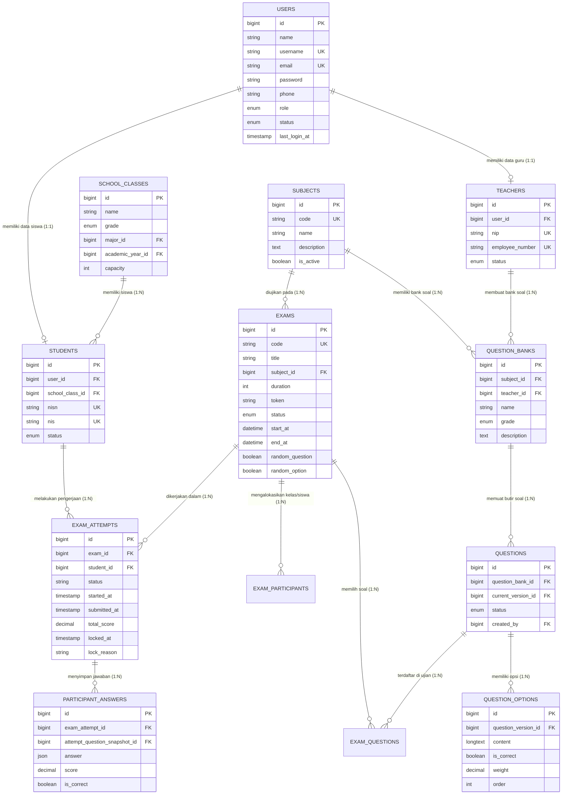

# Entity Relationship Diagram (ERD) & Spesifikasi Tabel Data
## Sistem Computer Based Test (SAPTA CBT)
*(Model Notasi Chen & Kamus Data Basis Data)*

---

## 1. Visualisasi ERD Model Chen (Sesuai Referensi)

Diagram ini mengadopsi **Notasi Chen** sebagaimana gambar referensi yang menggunakan:
- 🟦 **Persegi Panjang (Rectangles):** Merepresentasikan **Entitas / Tabel**
- 🔷 **Belah Ketupat (Diamonds):** Merepresentasikan **Relasi / Hubungan** antar entitas
- ⚪ **Elips / Oval:** Merepresentasikan **Atribut** (Kolom Data) yang bercabang dari entitasnya (Atribut berkode emas bergaris bawah merupakan *Primary Key*)

> 💡 **Tautan Berkas:**
> - Versi Gambar HD (PNG 2600x1850 px): [public/docs/erd_chen_reference.png](file:///c:/laragon/www/cbt-sapmar/public/docs/erd_chen_reference.png)
> - Versi Grafis Vektor (SVG): [public/docs/erd_chen_reference.svg](file:///c:/laragon/www/cbt-sapmar/public/docs/erd_chen_reference.svg)
> - Viewer Interaktif di Web (Zoom, Pan & Cetak): Buka browser di [http://127.0.0.1:8000/docs/erd.html](http://127.0.0.1:8000/docs/erd.html)

---

## 2. Diagram Relasi Entitas Berbasis Teks (Mermaid ERD)

---

## 3. Spesifikasi Tabel Data (Data Dictionary)

Berikut rincian spesifikasi skema basis data dari setiap entitas tabel utama dalam sistem CBT:

### 1. Tabel: `users` (Data Akun & Autentikasi Pengguna)
* **Fungsi:** Menyimpan akun terpusat untuk semua peran (Super Admin, Kurikulum, Guru, Siswa, Proktor).

| Kolom | Tipe Data | Constraint | Deskripsi & Fungsi |
| :--- | :--- | :--- | :--- |
| `id` | BIGINT UNSIGNED | **PK**, Auto Increment | Identifier unik pengguna. |
| `name` | VARCHAR(255) | NOT NULL | Nama lengkap pengguna. |
| `username` | VARCHAR(255) | **UNIQUE**, NOT NULL | Username untuk login (NISN / NIP / Username Admin). |
| `email` | VARCHAR(255) | **UNIQUE**, NOT NULL | Alamat email resmi pengguna. |
| `password` | VARCHAR(255) | NOT NULL | Hash password terenkripsi (Bcrypt). |
| `phone` | VARCHAR(20) | NULLABLE | Nomor telepon/WhatsApp. |
| `avatar` | VARCHAR(255) | NULLABLE | Alamat path berkas foto profil. |
| `status` | ENUM('active','inactive','suspended') | DEFAULT 'active' | Status keaktifan akun. |
| `last_login_at`| TIMESTAMP | NULLABLE | Waktu login terakhir. |
| `last_login_ip`| VARCHAR(45) | NULLABLE | Alamat IP login terakhir. |
| `created_at` | TIMESTAMP | NULLABLE | Waktu pencatatan data. |
| `updated_at` | TIMESTAMP | NULLABLE | Waktu pembaruan data terakhir. |

---

### 2. Tabel: `teachers` (Profil Guru / Penguji)
* **Fungsi:** Menyimpan data spesifik pengajar/guru yang berelasi dengan tabel `users`.

| Kolom | Tipe Data | Constraint | Deskripsi & Fungsi |
| :--- | :--- | :--- | :--- |
| `id` | BIGINT UNSIGNED | **PK**, Auto Increment | Identifier unik data guru. |
| `user_id` | BIGINT UNSIGNED | **FK** -> `users.id`, CASCADE | Relasi ke akun login pengguna. |
| `nip` | VARCHAR(30) | **UNIQUE**, NULLABLE | Nomor Induk Pegawai resmi. |
| `employee_number` | VARCHAR(30) | **UNIQUE**, NULLABLE | Nomor tenaga pendidik/GTK sekolah. |
| `status` | ENUM('active','inactive') | DEFAULT 'active' | Status pengajar. |
| `created_at` | TIMESTAMP | NULLABLE | Waktu pembuatan data. |
| `updated_at` | TIMESTAMP | NULLABLE | Waktu perubahan data. |

---

### 3. Tabel: `students` (Profil Siswa / Peserta Ujian)
* **Fungsi:** Menyimpan biodata akademik siswa yang berelasi dengan akun `users` dan rombel `school_classes`.

| Kolom | Tipe Data | Constraint | Deskripsi & Fungsi |
| :--- | :--- | :--- | :--- |
| `id` | BIGINT UNSIGNED | **PK**, Auto Increment | Identifier unik siswa. |
| `user_id` | BIGINT UNSIGNED | **FK** -> `users.id`, CASCADE | Relasi ke akun login pengguna. |
| `school_class_id` | BIGINT UNSIGNED | **FK** -> `school_classes.id`, NULL | Relasi ke rombel/kelas siswa saat ini. |
| `nisn` | VARCHAR(20) | **UNIQUE**, NULLABLE | Nomor Induk Siswa Nasional (10 digit). |
| `nis` | VARCHAR(20) | **UNIQUE**, NULLABLE | Nomor Induk Siswa internal sekolah. |
| `status` | ENUM('active','inactive','graduated','dropped') | DEFAULT 'active' | Status akademik siswa. |
| `created_at` | TIMESTAMP | NULLABLE | Waktu pendaftaran. |
| `updated_at` | TIMESTAMP | NULLABLE | Waktu perubahan. |

---

### 4. Tabel: `school_classes` (Kelas / Rombongan Belajar)
* **Fungsi:** Menyimpan data rombel kelas tempat siswa bernaung (misal: "X RPL 1", "XII TKJ 2").

| Kolom | Tipe Data | Constraint | Deskripsi & Fungsi |
| :--- | :--- | :--- | :--- |
| `id` | BIGINT UNSIGNED | **PK**, Auto Increment | Identifier unik rombel kelas. |
| `name` | VARCHAR(255) | NOT NULL | Nama rombel (misal: "X AKL 1"). |
| `grade` | ENUM('X','XI','XII') | NOT NULL | Tingkat jenjang kelas. |
| `major_id` | BIGINT UNSIGNED | **FK** -> `majors.id`, CASCADE | Relasi ke program keahlian / jurusan. |
| `academic_year_id` | BIGINT UNSIGNED | **FK** -> `academic_years.id`, CASCADE | Relasi ke tahun pelajaran aktif. |
| `capacity` | INT | DEFAULT 36 | Daya tampung kuota siswa kelas. |
| `is_active` | BOOLEAN | DEFAULT TRUE | Status keaktifan rombel. |
| `created_at` | TIMESTAMP | NULLABLE | Waktu pembuatan data. |
| `updated_at` | TIMESTAMP | NULLABLE | Waktu perubahan. |

---

### 5. Tabel: `subjects` (Mata Pelajaran)
* **Fungsi:** Menyimpan daftar mata pelajaran kurikulum yang diajarkan dan diujikan.

| Kolom | Tipe Data | Constraint | Deskripsi & Fungsi |
| :--- | :--- | :--- | :--- |
| `id` | BIGINT UNSIGNED | **PK**, Auto Increment | Identifier unik mata pelajaran. |
| `code` | VARCHAR(20) | **UNIQUE**, NOT NULL | Kode unik mata pelajaran (misal: "MTK", "BINDO"). |
| `name` | VARCHAR(255) | NOT NULL | Nama mata pelajaran. |
| `description` | TEXT | NULLABLE | Penjelasan ringkas silabus/materi. |
| `is_active` | BOOLEAN | DEFAULT TRUE | Status ketersediaan mapel. |
| `created_at` | TIMESTAMP | NULLABLE | Waktu pembuatan data. |
| `updated_at` | TIMESTAMP | NULLABLE | Waktu perubahan. |

---

### 6. Tabel: `question_banks` (Bank Soal)
* **Fungsi:** Mengelompokkan paket kumpulan butir pertanyaan untuk mata pelajaran dan tingkatan kelas tertentu.

| Kolom | Tipe Data | Constraint | Deskripsi & Fungsi |
| :--- | :--- | :--- | :--- |
| `id` | BIGINT UNSIGNED | **PK**, Auto Increment | Identifier unik bank soal. |
| `subject_id` | BIGINT UNSIGNED | **FK** -> `subjects.id`, CASCADE | Relasi ke mata pelajaran. |
| `teacher_id` | BIGINT UNSIGNED | **FK** -> `teachers.id`, CASCADE | Guru pemilik/penyusun bank soal. |
| `grade` | ENUM('X','XI','XII') | NULLABLE | Target jenjang kelas. |
| `name` | VARCHAR(255) | NOT NULL | Nama paket bank soal. |
| `description` | TEXT | NULLABLE | Catatan atau kisi-kisi bank soal. |
| `archived_at` | TIMESTAMP | NULLABLE | Penanda soft-delete / arsip. |
| `created_at` | TIMESTAMP | NULLABLE | Waktu pembuatan. |
| `updated_at` | TIMESTAMP | NULLABLE | Waktu pengeditan. |

---

### 7. Tabel: `questions` (Induk Butir Soal)
* **Fungsi:** Menyimpan identitas butir pertanyaan dan mengelola riwayat versi (*versioning*).

| Kolom | Tipe Data | Constraint | Deskripsi & Fungsi |
| :--- | :--- | :--- | :--- |
| `id` | BIGINT UNSIGNED | **PK**, Auto Increment | Identifier unik butir soal. |
| `question_bank_id` | BIGINT UNSIGNED | **FK** -> `question_banks.id`, CASCADE | Bank soal induk. |
| `current_version_id`| BIGINT UNSIGNED | **FK** -> `question_versions.id`, NULL | Versi soal aktif yang digunakan saat ini. |
| `status` | ENUM('DRAFT','REVIEW','APPROVED','PUBLISHED','ARCHIVED') | DEFAULT 'DRAFT' | Status siklus hidup butir soal. |
| `created_by` | BIGINT UNSIGNED | **FK** -> `users.id`, CASCADE | Pembuat butir pertanyaan. |
| `created_at` | TIMESTAMP | NULLABLE | Waktu pembuatan butir soal. |
| `updated_at` | TIMESTAMP | NULLABLE | Waktu perubahan butir soal. |

---

### 8. Tabel: `question_versions` & `question_options` (Konten Soal & Pilihan Jawaban)
* **Fungsi:** Menyimpan konten soal terformat, formula matematika, dan daftar pilihan jawaban beserta bobot nilai.

| Kolom | Tipe Data | Constraint | Deskripsi & Fungsi |
| :--- | :--- | :--- | :--- |
| `id` | BIGINT UNSIGNED | **PK**, Auto Increment | Identifier unik versi soal / opsi. |
| `type` | ENUM | NOT NULL | Tipe soal (`multiple_choice`, `complex_multiple_choice`, `true_false`, `matching`, `short_answer`, `essay`). |
| `content` | LONGTEXT | NOT NULL | Isi teks soal / teks pilihan (HTML + KaTeX). |
| `is_correct` | BOOLEAN | DEFAULT FALSE | Penanda kunci jawaban yang benar. |
| `weight` | DECIMAL(8,2) | DEFAULT 0.00 | Bobot nilai per butir / per opsi jawaban. |

---

### 9. Tabel: `exams` (Jadwal & Konfigurasi Ujian)
* **Fungsi:** Mengatur pelaksanaan ujian, jadwal buka/tutup, durasi pengerjaan, token, dan mekanisme pengacakan.

| Kolom | Tipe Data | Constraint | Deskripsi & Fungsi |
| :--- | :--- | :--- | :--- |
| `id` | BIGINT UNSIGNED | **PK**, Auto Increment | Identifier unik jadwal ujian. |
| `title` | VARCHAR(255) | NOT NULL | Judul ujian (misal: "Penilaian Akhir Semester Ganjil"). |
| `code` | VARCHAR(255) | **UNIQUE**, NOT NULL | Kode referensi ujian. |
| `subject_id` | BIGINT UNSIGNED | **FK** -> `subjects.id`, CASCADE | Mata pelajaran yang diujikan. |
| `duration` | INT | NOT NULL | Alokasi durasi pengerjaan (dalam menit). |
| `start_at` | DATETIME | NULLABLE | Waktu mulai ujian dapat diakses. |
| `end_at` | DATETIME | NULLABLE | Waktu akhir batas pengerjaan ujian. |
| `token` | VARCHAR(10) | NULLABLE | Kode token autentikasi pengerjaan siswa. |
| `random_question` | BOOLEAN | DEFAULT TRUE | Pengacakan urutan nomor butir soal. |
| `random_option` | BOOLEAN | DEFAULT TRUE | Pengacakan urutan pilihan (A, B, C, D, E). |
| `status` | ENUM | DEFAULT 'DRAFT' | Status ujian (`DRAFT`, `SCHEDULED`, `OPEN`, `ENDED`, `GRADED`). |
| `created_by` | BIGINT UNSIGNED | **FK** -> `users.id`, CASCADE | Pendidik/Admin yang menerbitkan ujian. |

---

### 10. Tabel: `exam_attempts` (Sesi Pengerjaan Siswa)
* **Fungsi:** Merekam status sesi ujian siswa secara individual (waktu mulai, selesai, skor total, dan status lock pengawas).

| Kolom | Tipe Data | Constraint | Deskripsi & Fungsi |
| :--- | :--- | :--- | :--- |
| `id` | BIGINT UNSIGNED | **PK**, Auto Increment | Identifier unik sesi pengerjaan siswa. |
| `exam_id` | BIGINT UNSIGNED | **FK** -> `exams.id`, CASCADE | Ujian yang sedang dikerjakan. |
| `student_id` | BIGINT UNSIGNED | **FK** -> `students.id`, CASCADE | Siswa yang mengerjakan ujian. |
| `status` | VARCHAR(30) | DEFAULT 'NOT_STARTED' | Status pengerjaan (`IN_PROGRESS`, `SUBMITTED`, `AUTO_SUBMITTED`). |
| `attempt_number` | INT | DEFAULT 1 | Urutan percobaan pengerjaan (ke-1, ke-2, dst). |
| `started_at` | TIMESTAMP | NULLABLE | Waktu persis siswa menekan tombol mulai. |
| `submitted_at` | TIMESTAMP | NULLABLE | Waktu siswa menekan submit selesai. |
| `deadline_at` | TIMESTAMP | NULLABLE | Batas akhir waktu ujian siswa (waktu mulai + durasi). |
| `total_score` | DECIMAL(8,2) | NULLABLE | Akumulasi total skor akhir yang diraih siswa. |
| `locked_at` | TIMESTAMP | NULLABLE | Waktu sesi dikunci pengawas jika melanggar. |
| `lock_reason` | TEXT | NULLABLE | Alasan penguncian layar ujian oleh proktor. |

---

### 11. Tabel: `participant_answers` (Jawaban Siswa per Butir Soal)
* **Fungsi:** Menyimpan respon jawaban siswa secara real-time (autosave), hasil evaluasi otomatis, dan skor koreksi esai guru.

| Kolom | Tipe Data | Constraint | Deskripsi & Fungsi |
| :--- | :--- | :--- | :--- |
| `id` | BIGINT UNSIGNED | **PK**, Auto Increment | Identifier unik jawaban. |
| `exam_attempt_id` | BIGINT UNSIGNED | **FK** -> `exam_attempts.id`, CASCADE | Sesi ujian terkait. |
| `attempt_question_snapshot_id` | BIGINT UNSIGNED | **FK**, CASCADE | Snapshot butir soal yang dijawab. |
| `answer` | JSON | NULLABLE | Payload respon jawaban siswa (array ID opsi / teks esai). |
| `score` | DECIMAL(8,2) | DEFAULT 0.00 | Skor yang diperoleh untuk butir pertanyaan ini. |
| `is_correct` | BOOLEAN | NULLABLE | Penanda kebenaran jawaban pilihan. |
| `client_timestamp` | BIGINT | DEFAULT 0 | Penanda waktu pengiriman respon dari gawai siswa. |

