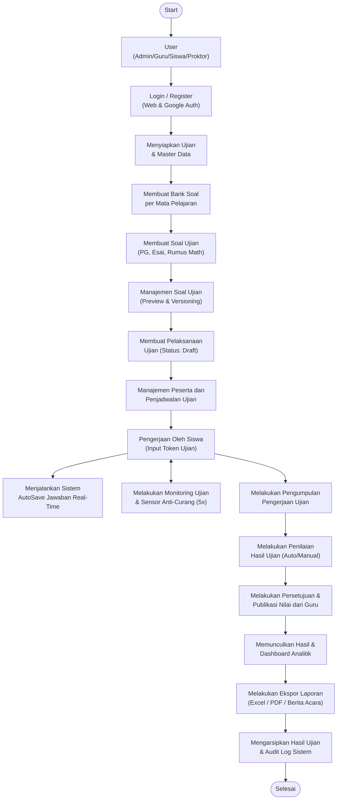

# Flowchart Sistem — CBT SAPMAR
*(Diagram Alir Sistem Berbasis Referensi Arsitektur End-to-End)*

Dokumen ini memodelkan diagram alir sistem (**System Flowchart**) dari platform Computer Based Test (**SAPTA CBT**), mengikuti tata letak bertingkat (*stepped layout*) sebagaimana gambar referensi yang menggambarkan siklus pelaksanaan ujian digital dari awal hingga pengarsipan.

---

## 1. Visualisasi Flowchart Sistem (Sesuai Referensi)

Diagram ini mengadopsi notasi flowchart standar:
- 🟢 **Oval / Terminator:** Titik awal (**Start**) dan titik akhir (**Selesai**).
- 🟦 **Persegi Panjang:** Tahapan proses aktivitas sistem dan peran pengguna.
- 🔀 **Percabangan Pengerjaan:** Pengerjaan siswa bercabang ke **Sistem Autosave Jawaban** di sisi kiri, **Monitoring Ujian & Sensor Integritas** di tengah, serta **Pengumpulan Pengerjaan Ujian** di sisi kanan menuju proses penilaian.

> 💡 **Tautan Berkas:**
> - Versi Gambar HD (PNG 1600x2300 px): [public/docs/flowchart_sistem_cbt.png](file:///c:/laragon/www/cbt-sapmar/public/docs/flowchart_sistem_cbt.png)
> - Versi Vektor Skalabel (SVG): [public/docs/flowchart_sistem_cbt.svg](file:///c:/laragon/www/cbt-sapmar/public/docs/flowchart_sistem_cbt.svg)
> - Viewer Interaktif di Web (Zoom, Pan & Cetak): Buka browser di [http://127.0.0.1:8000/docs/flowchart_sistem.html](http://127.0.0.1:8000/docs/flowchart_sistem.html)

---

## 2. Diagram Alir Berbasis Teks (Mermaid Syntax)

---

## 3. Rincian Penjelasan 16 Tahapan Alur Flowchart Sistem

Berikut uraian teknis setiap blok proses yang terdapat dalam flowchart sistem:

| No | Nama Blok Proses | Deskripsi & Implementasi Sistem |
| :--- | :--- | :--- |
| **1** | **Start** | Titik awal inisialisasi ketika pengguna mengakses domain portal CBT. |
| **2** | **User** | Entitas pengguna sistem yang terdiri dari 4 peran: Super Admin, Kurikulum, Guru Mata Pelajaran, Siswa, dan Proktor/Pengawas. |
| **3** | **Login / Register** | Mekanisme autentikasi kredensial (Username/Password atau Google Auth) dengan validasi role dan sesi aktif (middleware Laravel). |
| **4** | **Menyiapkan Ujian** | Persiapan data prasyarat oleh Kurikulum: tahun ajaran, jurusan, kelas/rombel, dan penugasan guru pengampu mapel. |
| **5** | **Membuat Bank Soal** | Pengelompokan wadah butir pertanyaan berdasarkan mata pelajaran, tingkatan jenjang, dan guru pemilik. |
| **6** | **Membuat Soal Ujian** | Input butir soal dengan format kaya: Pilihan Ganda, Pilihan Kompleks, Benar/Salah, Menjodohkan, Isian, Esai, serta formula matematika KaTeX/MathQuill & lampiran media gambar/audio. |
| **7** | **Manajemen Soal Ujian** | Pengelolaan riwayat versi soal (*question versioning*), pratinjau tampilan soal (*preview render*), dan pengubahan status (Draft/Published). |
| **8** | **Membuat Pelaksanaan Ujian** | Pembuatan paket ujian per mata pelajaran: durasi menit, batas tanggal/jam mulai, token ujian, dan parameter acak soal/opsi (status awal: `DRAFT`). |
| **9** | **Manajemen Peserta & Penjadwalan** | Penetapan peserta ujian per rombel kelas, penambahan peserta susulan/ekstra, penerbitan BAP/daftar hadir, penugasan Proktor, dan publikasi status ujian ke `ON GOING`. |
| **10**| **Pengerjaan Oleh Siswa** | Siswa membuka siaran ujian, memasukkan kode token yang dibagikan proktor di ruangan, dan memulai pengerjaan paket snapshot soal. |
| **-** | **• Menjalankan Sistem AutoSave Jawaban** *(Cabang Kiri)* | Sistem otomatis menyimpan pilihan/jawaban siswa ke server secara background per nomor soal untuk mencegah kehilangan data jika gawai padam. |
| **-** | **• Melakukan Monitoring Ujian** *(Cabang Tengah)* | Proktor memantau live status siswa; sensor anti-curang aktif mengawasi 8 pelanggaran (tab switch, blur, fullscreen exit) dengan toleransi limit 5x sebelum akun terblokir. |
| **-** | **• Melakukan Pengumpulan Pengerjaan Ujian** *(Cabang Kanan)* | Penyerahan lembar respon ujian secara mandiri oleh siswa atau paksa tutup otomatis (*auto-submit*) saat waktu hitung mundur habis. |
| **11**| **Melakukan Penilaian Hasil Ujian** | Evaluasi otomatis (*Auto-Grading*) untuk butir pilihan objektif; koreksi manual oleh guru pengampu untuk butir soal esai/uraian. |
| **12**| **Melakukan Persetujuan & Publikasi Nilai** | Guru memeriksa kembali rekapitulasi skor akhir dan menekan tombol publikasi hasil agar nilai resmi rilis ke akun siswa. |
| **13**| **Memunculkan Hasil & Dashboard Analitik** | Tampilan visual metrik ketuntasan belajar, distribusi nilai, skor tertinggi/terendah, dan analisis butir soal pada dashboard. |
| **14**| **Melakukan Ekspor Laporan** | Pengunduhan rekap nilai dalam format lembar kerja Excel, cetak laporan nilai resmi PDF, dan pengarsipan Berita Acara Pelaksanaan (BAP). |
| **15**| **Mengarsipkan** | Penyimpanan permanen riwayat ujian dan perekaman rekam jejak audit (*audit logs*) untuk keperluan akreditasi sekolah. |
| **16**| **Selesai** | Titik akhir siklus pelaksanaan ujian. |

