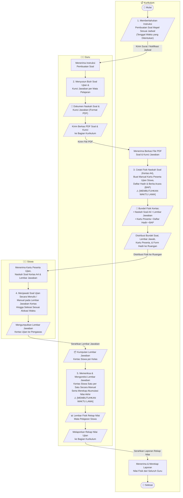

# Swimlane Activity Diagram — Alur Sistem Ujian Yang Sedang Berjalan
*(Sistem Konvensional / Manual Berbasis Kertas — As-Is Workflow)*

Dokumen ini memodelkan alur proses ujian konvensional berbasis kertas yang saat ini sedang berjalan (*As-Is System*) sebelum diterapkannya sistem Computer Based Test (CBT), menguraikan interaksi antara bagian **Kurikulum**, **Guru**, dan **Siswa** dalam bentuk **Swimlane Diagram**.

---

## 1. Gambar Swimlane Diagram (Sesuai Referensi)

Diagram ini mengadopsi format jalur vertikal (*lanes*) sebagaimana gambar referensi:
- **Jalur 1: Kurikulum** (Instruksi, penggandaan kertas A4, administrasi manual kartu & BAP, rekap akhir)
- **Jalur 2: Guru** (Penyusunan naskah soal PDF, koreksi fisik lembar jawaban satu per satu, laporan nilai)
- **Jalur 3: Siswa** (Pengerjaan soal tulis tangan di lembar kertas)

> 💡 **Tautan Berkas:**
> - Versi Gambar HD (PNG 1800x2200 px): [public/docs/swimlane_manual_system.png](file:///c:/laragon/www/cbt-sapmar/public/docs/swimlane_manual_system.png)
> - Versi Vektor Skalabel (SVG): [public/docs/swimlane_manual_system.svg](file:///c:/laragon/www/cbt-sapmar/public/docs/swimlane_manual_system.svg)
> - Viewer Interaktif di Web (Zoom, Pan & Cetak): Buka browser di [http://127.0.0.1:8000/docs/swimlane_manual.html](http://127.0.0.1:8000/docs/swimlane_manual.html)

---

## 2. Diagram Alir Swimlane Berbasis Teks (Mermaid Syntax)

---

## 3. Rincian Penjelasan 5 Tahapan Alur Sistem Yang Sedang Berjalan

Berikut analisis deskriptif dari setiap tahapan proses manual sistem konvensional:

### 1. Instruksi Pembuatan Soal oleh Kurikulum
* Bagian **Kurikulum** menerbitkan surat pemberitahuan atau instruksi dinas sekolah kepada seluruh **Guru mata pelajaran** untuk membuat naskah soal ujian semester / penilaian harian sesuai dengan kalender akademik dan batas tanggal (*deadline*) yang telah ditetapkan.

### 2. Penyusunan Soal & Kunci Jawaban Berbentuk PDF oleh Guru
* Masing-masing Guru menyusun butir soal ujian (pilihan ganda dan uraian) beserta kunci jawaban dan kisi-kisi soal menggunakan aplikasi pengolah kata (*Word processor*), kemudian mengonversinya menjadi dokumen digital berformat **PDF**.
* Berkas PDF naskah soal dan kunci jawaban tersebut dikirimkan kepada bagian Kurikulum melalui media pesan instan (*WhatsApp*), surel (*email*), atau *flashdisk*.

### 3. Penggandaan Kertas A4 & Administrasi Manual oleh Kurikulum *(Titik Bottleneck / Lambat)*
* Bagian Kurikulum mencetak (*print out*) dan menggandakan / memfotokopi naskah soal menggunakan **kertas HVS A4** dalam jumlah ribuan lembar sesuai dengan jumlah siswa dan kelas.
* Kurikulum juga harus membuat secara manual lembar administrasi ujian:
  - Pembuatan dan pencetakan **Kartu Peserta Ujian Siswa** (harus dipotong dan dicap satu per satu).
  - Pembuatan format lembar **Daftar Hadir Siswa** per rombel.
  - Pembuatan format lembar **Berita Acara Pelaksanaan (BAP)** untuk pengawas ruangan.
* **Kendala yang Terjadi:** Proses ini memakan waktu yang sangat lama (berhari-hari), membutuhkan biaya pengadaan kertas dan tinta yang tinggi (*high printing cost*), serta rawan terjadi kebocoran naskah soal fisik.

### 4. Pelaksanaan Ujian Tulis Tangan oleh Siswa
* Pada hari pelaksanaan ujian, siswa menerima naskah soal kertas A4 dan lembar jawaban.
* Siswa menjawab butir pertanyaan dengan **menulis secara manual** menggunakan pena / pensil hingga waktu durasi ujian berakhir.
* Lembar jawaban fisik dikumpulkan oleh pengawas ruangan dan diserahkan kembali ke sekolah.

### 5. Pemeriksaan Manual & Rekapitulasi Nilai oleh Guru
* Guru menerima tumpukan bundel lembar jawaban kertas siswa.
* Guru mengoreksi jawaban siswa **satu per satu secara manual**, menghitung akumulasi skor, dan mencatat nilai ke dalam buku rekap nilai fisik atau lembar rekapitulasi.
* Hasil nilai fisik yang telah direkap kemudian dilaporkan secara resmi ke bagian Kurikulum untuk dimasukkan ke buku rapor.
* **Kendala yang Terjadi:** Proses koreksi manual memerlukan waktu berhari-hari hingga berminggu-minggu, rawan kesalahan perhitungan (*human error*), dan siswa tidak bisa langsung mengetahui hasil evaluasinya.

---

### ⚖️ Perbandingan: Sistem Sedang Berjalan (Manual) vs Sistem Akan Dikembangkan (CBT)

| Indikator | Sistem Sedang Berjalan (Manual Kertas) | Sistem Baru (CBT SAPMAR) |
| :--- | :--- | :--- |
| **Media Soal & Jawaban** | Naskah cetak kertas A4 & lembar tulis tangan. | Layar gawai digital (responsif komputer/ponsel). |
| **Administrasi Ujian** | Cetak kartu, daftar hadir, dan BAP manual berhari-hari. | Otomatis dibuat & dicetak sekali klik dari sistem. |
| **Penyimpanan Soal** | File PDF tersebar di flashdisk/email guru. | Tersimpan rapi dalam **Bank Soal terpusat** dengan formula KaTeX. |
| **Koreksi & Penilaian** | Guru memeriksa lembar kertas satu per satu manual. | **Auto-Grading instan** untuk pilihan ganda; koreksi esai digital langsung di web. |
| **Keamanan & Integritas** | Rawan contek fisik, kertas tercecer, atau bocor. | **Engine Anti-Cheat:** limit 5x pelanggaran, deteksi tab switch & live monitoring proktor. |
| **Waktu Pengumuman Nilai** | Butuh waktu 1–2 minggu setelah ujian selesai. | **Real-time:** Langsung dipublikasikan guru setelah koreksi esai selesai. |

